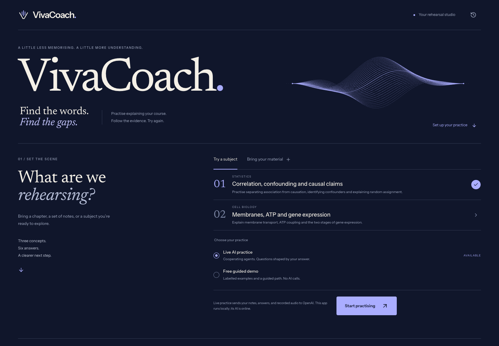
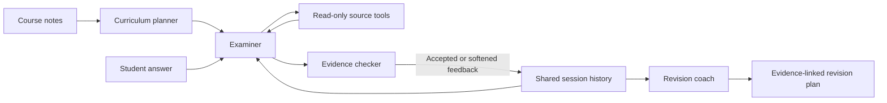

# VivaCoach

**Explain it aloud. Find out what needs another look.**

VivaCoach turns course material into a short oral revision session. A student explains a concept, answers an adaptive follow-up, and receives feedback that points to their own words and the supplied notes. Built for GreatUniHack's Reply **AI on Campus** challenge, with teaching and learning at its centre.



## Start locally

Requires Node.js 24 or newer and pnpm 11.25.0.

```sh
pnpm install --frozen-lockfile
cp .env.example .env.local
pnpm dev
```

Open **http://localhost:3000**. On the development Mac, `start-local.command` also starts the app using an installed or Codex-bundled Node runtime.

The guided demo works without an API key. To use live revision, set `OPENAI_API_KEY` and `VIVACOACH_LIVE_AI=true` in `.env.local`, then restart. Keep the key out of browser code and Git. No Supabase, Vercel, or account signup is needed.

```sh
pnpm typecheck
pnpm test
pnpm build
pnpm start
```

## What to try

1. Choose the statistics or cell biology sample, or import a selectable-text PDF, text file, Markdown file, or pasted notes.
2. Start a live practice or the free guided demo.
3. Speak an answer and review its transcript before submitting, or type directly.
4. Watch the examiner retrieve source material and the evidence checker review its proposed feedback.
5. Answer the follow-up. Finish after six answers, or end early for a review of the work actually completed.

The demo's **Use example answer** button inserts an explicitly authored answer. Demo feedback is a walkthrough, not a live AI assessment. Its microphone lets you rehearse locally; live transcription is available in live mode.

## Four cooperating agents



- **Planner:** selects three concepts and links them to exact excerpts from the provided material.
- **Examiner:** uses a bounded source-retrieval tool loop and proposes a claim-specific follow-up.
- **Evidence checker:** runs independently, checks the interpretation against the answer and notes, and can reject unsupported feedback. Code also validates quote provenance.
- **Coach:** turns accepted session evidence into strengths, revision priorities, and next steps linked to actual answers and sources.

The agents share structured state through the server. Each has a separate prompt and output contract. Activity messages describe completed work and handoffs; they do not expose private model reasoning. They use the same economical model by default; separate roles do not require separate model providers.

## Voice and cost controls

OpenAI `gpt-transcribe` transcribes bounded recordings. ElevenLabs can speak the examiner's opening questions and adaptive follow-ups; the four agents still decide what to ask and how to assess the answer.

To enable ElevenLabs:

1. Create a key in the [ElevenLabs API dashboard](https://elevenlabs.io/app/api/api-keys) with Text to Speech access.
2. Save it as `ELEVENLABS_API_KEY` in `.env.local`. The default voice is **George** (`JBFqnCBsd6RMkjVDRZzb`); change `ELEVENLABS_VOICE_ID` to use another voice available to your account.
3. Keep `VIVACOACH_LIVE_AI=true`, restart the server, and refresh the browser.
4. Start a **live practice** and select **Hear the question**. The playback label names ElevenLabs, or explicitly identifies device fallback if synthesis or playback fails.

The key stays on the server. Only the current saved question can be synthesised, using `eleven_flash_v2_5`. Audio is generated on demand and cached in memory; replaying a cached question makes no new provider request, including after the generation cap is reached. Cache entries can expire through eviction or server restart. **Cancel playback** stops a pending playback; a generation already sent to ElevenLabs may still be billed. Without a key, and in the free guided demo, the app uses device speech.

Default caps per server process are 60 text model requests, 12 transcription requests, and 30 ElevenLabs requests. Failed attempts count. Calls have deadlines and no automatic retries. A practice has at most six submitted answers. The UI caps recordings at 90 seconds; the server caps audio at 2 MB, material at 30,000 characters, and each answer at 2,500 characters. Restarting the server resets request counters; these are usage limits, not a billing dashboard.

## Storage and scope

The app binds to this computer by default. An anonymous browser cookie owns its saved sessions. SQLite data lives in `.local/vivacoach.sqlite`; material, answers, and feedback stay out of Git. The app does not write recordings to disk.

**Local hosting does not mean offline AI.** In live mode, relevant course text and answers go to OpenAI, and recordings go to OpenAI for transcription. Optional ElevenLabs playback sends the examiner question to ElevenLabs. Device speech is managed by the browser and operating system.

This prototype supports English revision with selectable text, not OCR, diagrams, mathematical notation reconstruction, or formal grading. A checked quote proves where the text came from, not that every interpretation is correct. Feedback remains provisional and tied to the uploaded source; incorrect notes can lead to incorrect guidance. The six-answer structure is deliberately small enough for a reliable hackathon demo.

## Project files

- `src/`: React interface, microphone recording, PDF extraction, and device speech.
- `server/agents.ts`: planner, tool-using examiner, independent verifier, and revision coach.
- `server/practices.ts`: persisted state, bounded practice flow, and recovery.
- `server/voice.ts`: transcription and optional ElevenLabs audio.
- `tests/`: agent, persistence, provider-boundary, and browser checks.
- [Implementation decisions](docs/IMPLEMENTATION.md).
- [Demo walkthrough and pitch](docs/DEMO.md).
- [Validation and known limits](docs/VALIDATION.md).

Pairwise, the previous project, remains recoverable in `SH4D0W074/pairwise` at tag `pairwise-v1`. This branch is backed up separately to the private `SH4D0W074/vivacoach` repository.
