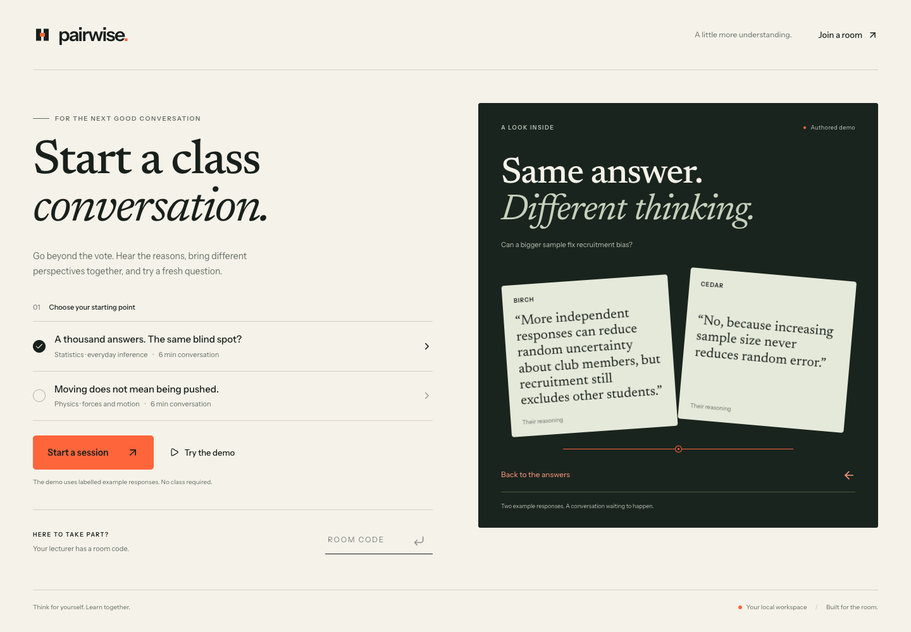

# Pairwise

Make room for reasoning. Pairwise helps a lecturer see the reasoning behind a class's answers, organise a focused peer discussion, and check a fresh independent response.

Pairwise is a local prototype for Reply’s **AI on Campus** challenge. It includes a lecturer workspace, a presentation wall and mobile student screens. Two authored lessons cover sampling bias and forces/motion.

**The loop:** independent answer and explanation → cautious reasoning review → lecturer-approved peer discussion → a fresh independent question → actual response counts and quotations.



Try the complete flow with **Try the demo**. Its responses, interpretations and follow-up answers are explicitly labelled authored examples; it makes no API calls. **Start a session** collects real responses. If live AI is disabled or unavailable, it offers clearly labelled comparison groups.

## Setup

Requires Node.js 24 or newer and pnpm 11.25.0. No Supabase, Vercel or cloud database is required.

```sh
pnpm install
cp .env.example .env.local
pnpm dev
```

Open <http://localhost:3000>. On the configured Mac, double-click `start-local.command` to start the installed app; it also finds the Codex-bundled Node runtime when Node is not on the normal path. Keep the terminal open while using the app.

The default server listens only on this computer. Use another browser or an incognito window for an independent student identity. Tabs in the same browser share an identity. Keep the lecturer’s original browser to retain its controls. The presentation wall can be opened with **Present**.

Rooms and anonymous sessions persist in `.local/pairwise.sqlite`; drafts remain in the student browser until submitted. Neither this database nor `.env.local` is backed up to GitHub. To erase local session data, stop the app and remove `.local/pairwise.sqlite` and its `-wal`/`-shm` files, if present. Do not do this while a session is in use.

For a compiled interface:

```sh
pnpm build
pnpm start
```

## Enable live AI

Edit `.env.local` on your machine, never in GitHub or the browser:

```dotenv
OPENAI_API_KEY=your_private_key
OPENAI_MODEL=gpt-6-luna
PAIRWISE_LIVE_AI=true
PAIRWISE_MAX_AI_CALLS=20
```

Restart the server after changing configuration. The [documented default model](https://developers.openai.com/api/docs/models/gpt-6-luna) supports Structured Outputs; your account still needs access to it. An explicit `OPENAI_MODEL` overrides the default. The owner's local account passed the live checks recorded in [validation notes](docs/VALIDATION.md); a different account or model needs its own check.

The server sends submitted explanations, choices and the authored lesson rubric to OpenAI only when live analysis is explicitly enabled and a lecturer starts a review. It asks for no response storage (`store: false`); this does not mean the provider has no operational retention. No names are collected, but students should avoid putting identifying details in explanations. Face-to-face discussions are not recorded.

Live analysis has a 30-second deadline, no automatic retries, a 6,000-output-token limit, and a default batch cap of eight explanations. Excess responses remain saved and explicitly unclassified; the lecturer can use comparison groups. Repeating analysis with the same cap does not advance to another batch. The configurable maximum is 40. See `.env.example` for settings.

`PAIRWISE_MAX_AI_CALLS` is a **per-server-process call limit**, not a currency spending limit; restarting resets it. The owner's local installation uses a ten-call limit. Three separately approved live verification calls cost an estimated $0.000775 in total. The normal automated tests stub the model and force live AI off in browser sessions.

## Checks

```sh
pnpm typecheck
pnpm test
pnpm build
pnpm exec playwright install chromium
pnpm test:e2e
```

On this Mac, an installed Chrome can be used without downloading another browser:

```sh
PAIRWISE_BROWSER_CHANNEL=chrome pnpm test:e2e
```

The tests cover evidence validation, uncertainty and failure fallbacks, pairing coverage, session permissions, private data filtering, persistence, and complete flows through separate browsers. The browser suite uses an isolated database and port 4173. CI runs the checks, builds the interface and exercises the browser flow.

See [the demonstration script](docs/DEMO.md), [architecture and implementation](docs/IMPLEMENTATION.md), and [validation notes](docs/VALIDATION.md).

## Product boundaries

Pairwise classifies expressed reasoning with uncertainty. It does not infer a student's ability or certify mastery. A short before/after demonstration illustrates a response change and is not evidence that the product improves learning.

Exact-quotation validation establishes where words came from; it does not establish that an AI interpretation is right. Lecturers review suggestions before groups are published. The two authored lessons are the supported scope; there is no slide upload, automatic course extraction, voice recording, n8n integration or university login in this build. Group discussion is face to face.

This is a local classroom prototype, not a service hardened for a public internet deployment. Keep the default loopback binding for this build. GitHub contains source code only.
